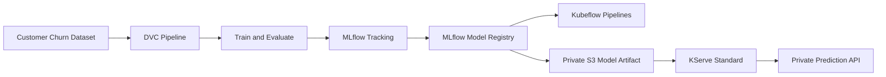

# Enterprise MLOps Platform

A reproducible end-to-end machine-learning platform for customer-churn
prediction, built with Python, DVC, MLflow, Kubeflow Pipelines, Kubernetes,
KServe, Amazon EKS, Amazon S3, Amazon ECR, Terraform, and GitHub Actions.

The project demonstrates how a DevOps or platform engineer can build,
validate, secure, operate, and document a complete MLOps workflow.

---

## Project status

| Area                             | Status     |
| -------------------------------- | ---------- |
| Deterministic dataset generation | Complete   |
| DVC data versioning              | Complete   |
| Reproducible ML pipeline         | Complete   |
| Model training and evaluation    | Complete   |
| MLflow experiment tracking       | Complete   |
| MLflow model registry            | Complete   |
| Kubeflow Pipelines integration   | Complete   |
| KServe Standard model serving    | Complete   |
| Private S3 model storage         | Complete   |
| EKS Pod Identity integration     | Complete   |
| SageMaker integration contract   | Documented |
| CI validation                    | Passing    |
| AWS workload teardown            | Complete   |

The platform was deployed and validated on Amazon EKS. The EKS workload
infrastructure was subsequently destroyed to avoid ongoing cloud charges.
The S3 artifact bucket and ECR repositories were intentionally retained.

---

## Business objective

The platform predicts whether a customer is likely to churn.

It provides a complete workflow for:

1. Creating a deterministic customer-churn dataset.
2. Versioning data and pipeline outputs with DVC.
3. Training and evaluating a scikit-learn model.
4. Tracking experiments with MLflow.
5. Registering and promoting a model through the MLflow registry.
6. Orchestrating ML workflows with Kubeflow Pipelines.
7. Serving the approved model with KServe.
8. Making predictions through a private Kubernetes service.
9. Preserving evidence for reproducibility, security, and operations.

---

## High-level architecture


## Platform components

| Layer               | Component                        | Responsibility                                  |
| ------------------- | -------------------------------- | ----------------------------------------------- |
| Source data         | Synthetic customer-churn dataset | Reproducible training input                     |
| Data versioning     | DVC                              | Tracks raw and processed data                   |
| ML pipeline         | Python and scikit-learn          | Prepares data, trains, and evaluates            |
| Experiment tracking | MLflow                           | Stores runs, parameters, metrics, and artifacts |
| Model registry      | MLflow Registry                  | Promotes the candidate model                    |
| Orchestration       | Kubeflow Pipelines               | Runs repeatable ML workflows                    |
| Object storage      | Amazon S3                        | Stores model artifacts                          |
| Model serving       | KServe                           | Hosts the production-style predictor            |
| Compute             | Amazon EKS                       | Runs Kubernetes platform workloads              |
| Container registry  | Amazon ECR                       | Stores immutable images                         |
| Identity            | EKS Pod Identity                 | Provides scoped AWS access to pods              |
| Infrastructure      | Terraform                        | Provisions AWS resources                        |
| CI                  | GitHub Actions                   | Runs tests and infrastructure validation        |

---

## Repository structure

```text
.
├── applications/
│   └── kserve-predictor/
│       ├── app.py
│       ├── Dockerfile
│       └── requirements.txt
├── data/
│   ├── processed/
│   └── raw/
├── docs/
│   ├── adr/
│   ├── evidence/
│   │   ├── kserve-validation.json
│   │   ├── kubeflow-pipelines-validation.json
│   │   └── sagemaker-validation.json
│   ├── images/
│   ├── kserve.md
│   ├── kubeflow-pipelines.md
│   └── sagemaker.md
├── kubernetes/
│   ├── base/
│   ├── overlays/
│   └── platform/
│       ├── kserve/
│       └── kubeflow-pipelines/
├── scripts/
│   ├── generate_dataset.py
│   ├── render_kfp_manifests.py
│   ├── render_kserve_manifests.py
│   └── service scripts
├── src/
│   ├── api/
│   └── training/
├── terraform/
│   ├── bootstrap/
│   ├── environments/
│   └── modules/
├── tests/
├── dvc.yaml
├── dvc.lock
├── params.yaml
├── pyproject.toml
└── README.md
```
---

# Reproducible machine-learning workflow

## 1. Dataset generation

The project generates a deterministic synthetic dataset containing 2,000
customer records.

The dataset includes:

- Customer tenure.
- Monthly charges.
- Total charges.
- Contract type.
- Internet service.
- Technical support.
- Online security.
- Paperless billing.
- Payment method.
- Dependents.
- Churn label.

The dataset generation process is deterministic so that the same source code
and parameters produce the same output.

## 2. DVC data versioning

DVC tracks the raw dataset and generated pipeline outputs.

```bash
source .venv/bin/activate

python scripts/generate_dataset.py
dvc repro
```
The DVC pipeline creates:

```text
data/processed/train.csv
data/processed/test.csv
```
Pipeline configuration is stored in:

```text
params.yaml
dvc.yaml
dvc.lock
```
## 3. Model training and evaluation

The model is trained with scikit-learn and evaluated using the reproducible
processed datasets.

Metrics are written to:

reports/metrics/metrics.json

## 4. MLflow tracking and registry

MLflow stores:

- Training parameters.
- Evaluation metrics.
- Model artifacts.
- Model signatures.
- Input examples.
- Model versions.

The validated model was promoted using the MLflow registry alias:

`customer-churn-model@candidate`

The model artifact was then exported into a serving package and uploaded to
private Amazon S3 storage.

---

# Kubeflow Pipelines

Kubeflow Pipelines provides workflow orchestration for repeatable machine
learning operations.

The project uses a standalone Kubeflow Pipelines deployment rather than the
complete Kubeflow distribution.

The deployment includes:

- Kubeflow Pipelines 2.17.0.
- Argo Workflows.
- MySQL metadata storage.
- SeaweedFS artifact storage.
- ML Metadata.
- cert-manager.
- Digest-pinned container images.
- Dedicated EKS scheduling capacity.
- Resource requests and limits.

The installation is rendered and hardened by:

`scripts/render_kfp_manifests.py`

The source versions, checksums, and image digests are recorded in:

`kubernetes/platform/kubeflow-pipelines/source-lock.json`

Detailed documentation:

`docs/kubeflow-pipelines.md`

---

# KServe model serving

The customer-churn model is served with KServe v0.20.0 in:

`Standard / RawDeployment mode`

Deployment characteristics:

| Setting          | Value                 |
| ---------------- | --------------------- |
| Namespace        | `kserve`              |
| InferenceService | `churn-model`         |
| Minimum replicas | 1                     |
| Maximum replicas | 1                     |
| Service type     | Private ClusterIP     |
| Knative          | Not installed         |
| Istio            | Not installed         |
| Public ingress   | Not created           |
| GPU              | Not required          |
| Model format     | scikit-learn          |
| Protocol         | V1 inference protocol |

The model is downloaded from:

`s3://enterprise-mlops-platform-dev-931058976119/kserve/customer-churn/v1`

The predictor uses:

`kserve-model-reader`

This ServiceAccount receives restricted S3 access through EKS Pod Identity.

Detailed documentation:

`docs/kserve.md`

---

# KServe runtime design

The default KServe scikit-learn runtime was replaced with a controlled,
digest-pinned runtime image built in this repository.

The custom predictor:

- Loads the model from /mnt/models.
- Exposes a Kubernetes HTTP endpoint.
- Accepts customer feature payloads.
- Returns churn predictions.
- Runs as an immutable ECR image.
- Uses explicit CPU and memory limits.

The image is defined in:

`applications/kserve-predictor/`

The serving runtime manifest is:

`kubernetes/platform/kserve/serving-runtime.yaml`

The InferenceService manifest is:

`kubernetes/platform/kserve/inference-service.yaml`

---

# Validated prediction

The live KServe predictor successfully returned:

```text
{
  "predictions": [1]
}
```
The model status endpoint returned:

```text
{
  "name": "churn-model",
  "ready": true
}
```
The predictor Pod reached:

`READY 1/1`

The storage initializer successfully downloaded the private S3 model artifact
using EKS Pod Identity.

---

# Security controls

## Identity and access
No static AWS credentials are stored in Kubernetes manifests.
EKS Pod Identity provides short-lived pod credentials.
The KServe ServiceAccount can read only the model S3 prefix.
S3 bucket public access is blocked.
S3 server-side encryption is enabled.

## Container security
Images are stored in Amazon ECR.
ECR repositories use immutable tags.
ECR scan-on-push is enabled.
Runtime images are pinned by SHA-256 digest.
Model-serving resources have explicit requests and limits.

## Kubernetes security
Model serving is isolated in the kserve namespace.
The predictor is exposed through a private ClusterIP service.
No public ingress was created.
KServe webhook traffic uses TLS.
Resource limits reduce noisy-neighbor risk.

## Infrastructure security
AWS infrastructure is managed through Terraform.
CI validates Terraform and Kubernetes changes.
Checkov scans infrastructure and Kubernetes manifests.
GitHub Actions runs automated tests and security checks.

---

# Immutable images

The validated runtime images include:

`kserve/storage-initializer@sha256:d7a3921d5fdc476739bc6fdcdc1ff3ba41421578620211fb6ac0e60c5541444a`

`931058976119.dkr.ecr.us-east-1.amazonaws.com/enterprise-mlops-platform-dev-kserve-transformer@sha256:5650a05184c7990ae9a026b8b2c8ef849ccc2038a7a0afc1e708a9ef45069589`

Digest pinning prevents a mutable tag from silently changing the deployed
runtime.

---

# SageMaker integration boundary

Amazon SageMaker is documented as an optional managed-serving integration.

This project intentionally does not maintain a paid SageMaker endpoint.

The SageMaker contract documents:

- Model artifact compatibility.
- S3 model packaging.
- Candidate-model promotion.
- Endpoint deployment considerations.
- IAM requirements.
- Cost and lifecycle considerations.
- The boundary between self-managed KServe and managed SageMaker serving.

Detailed documentation:

`docs/sagemaker.md`

---

# Validation evidence

Machine-readable validation records are stored in:

- KServe validation
- Kubeflow Pipelines validation
- SageMaker integration validation

The evidence records capture:

Component versions.
Deployment mode.
Namespace.
Readiness results.
Model storage URI.
Pod identity validation.
Prediction response.
Runtime image digests.
CI run information.
Final pass status.

---

# Local validation

Activate the project environment:

`source .venv/bin/activate`

Run the complete test suite:

`python -m pytest -q`

Run linting:

`ruff check src tests scripts applications`

Check whitespace errors:

`git diff --check`

Validate evidence JSON:

`jq empty docs/evidence/*.json`

Render the KServe contract:

```bash
python scripts/render_kserve_manifests.py \
  --source-lock kubernetes/platform/kserve/source-lock.json \
  --inference-service kubernetes/platform/kserve/inference-service.yaml \
  --serving-runtime kubernetes/platform/kserve/serving-runtime.yaml \
  --output-dir /tmp/project8-kserve-rendered
```
Expected result:

`PASS: KServe Standard contract rendered`

---

# Continuous integration

GitHub Actions validates:

- Python dependencies.
- Dataset reproducibility.
- DVC pipeline execution.
- Unit tests.
- Ruff linting.
- Terraform formatting.
- Terraform validation.
- Checkov infrastructure scans.
- Kubernetes manifest rendering.
- Immutable image validation.
- Container builds.
- Container security scans.

The final CI workflow completed successfully.

---

# Cost-control and teardown

The project was deployed to AWS for live validation and then safely torn
down.

Destroyed workload resources included:

- Amazon EKS cluster.
- EKS managed node groups.
- VPC and networking resources.
- NAT Gateway.
- MLflow and KServe runtime workloads.
- Temporary IAM and Pod Identity resources associated with the workload.

Retained resources include:

- S3 artifact bucket.
- ECR API repository.
- ECR MLflow repository.
- ECR KServe predictor repository.
- Terraform bootstrap/state resources where required.

This approach preserved model artifacts and container images while preventing
ongoing EKS and NAT Gateway charges.

---

# Engineering outcomes

This project demonstrates practical experience with:

- Reproducible ML pipelines.
- Data and model versioning.
- Kubernetes platform engineering.
- ML workload orchestration.
- Production-style model serving.
- AWS IAM and pod identity.
- Secure private artifact storage.
- Immutable container delivery.
- Infrastructure-as-code.
- CI/CD quality gates.
- Operational validation.
- Cost-aware cloud lifecycle management.

---

# License

This repository is a portfolio demonstration project.
